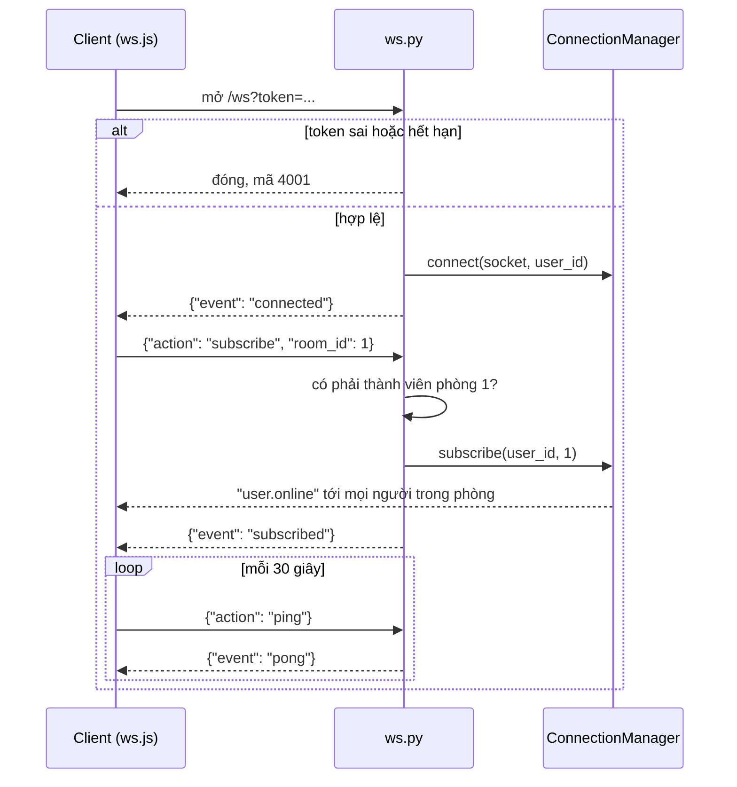
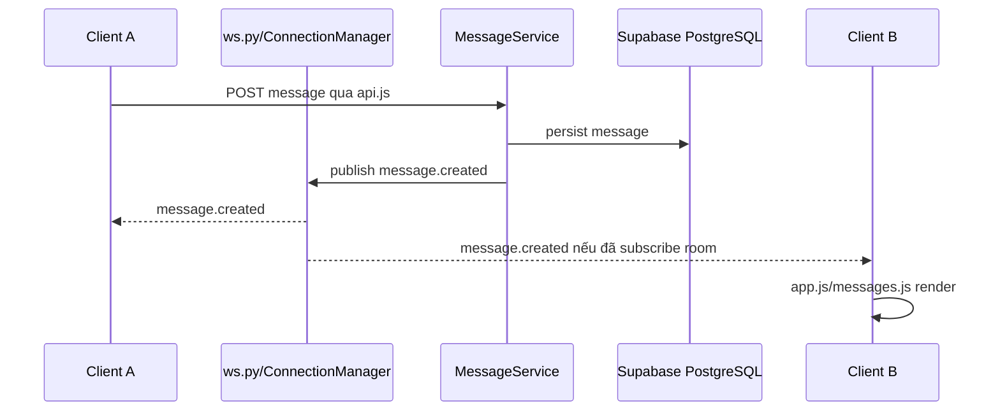

# 8. WebSocket và realtime

Một kết nối WebSocket mỗi tab, mở suốt phiên làm việc. Server dùng nó để **chủ động báo**
cho client; client dùng nó để đăng ký phòng, báo đang gõ, giữ kết nối và chuyển tín hiệu
WebRTC.

Trước khi có WebSocket, mỗi client hỏi lại API mỗi 2 giây — 30 request/phút/người kể cả khi
không có gì mới.

## Các thành phần

| Thành phần | File | Vai trò |
|---|---|---|
| Endpoint | `backend/app/api/routers/ws.py` | Bắt tay, kiểm tra token, đọc hành động từ client |
| `ConnectionManager` | `backend/app/infra/realtime/connection_manager.py` | Giữ danh sách kết nối; cài đặt cổng `IEventPublisher` |
| `IEventPublisher` | `backend/app/domain/interfaces/event_publisher.py` | Cổng mà service dùng để phát sự kiện |
| `realtime` | `frontend/js/ws.js` | Mở, nối lại, phân phát sự kiện tới bộ xử lý |

## Kết nối

```
wss://<host>/ws?token=<access_token>
```

Trình duyệt không gửi được header khi mở WebSocket, nên token nằm trong query string.



### Mã đóng kết nối

| Mã | Ai đóng | Lý do | Client làm gì |
|---|---|---|---|
| `4001` | Server | Token không hợp lệ | Đăng xuất, không nối lại |
| `4002` | Server | 90 giây không nhận được gì | Nối lại ngay |
| khác | Mạng | Rớt mạng, server khởi động lại | Nối lại, chờ 1 s → ×1,6 → tối đa 15 s |

Mã `4001` được gửi **trước khi** bắt tay xong, nên tùy trình duyệt có thể chỉ thấy mã `1006`.
Vì vậy `ws.js` có thêm lưới an toàn: chưa từng kết nối thành công mà thất bại **4 lần liên
tiếp** thì coi như phiên đã hết.

### Vì sao có hạn 90 giây

Khi client tắt máy hay rớt mạng, TCP có thể **không báo gì cả** — nhất là khi đi qua proxy
hoặc đường hầm. Server sẽ tưởng người đó vẫn online mãi, và nếu họ đang trong cuộc gọi thì
không ai gọi được họ nữa ("đang bận trong cuộc gọi khác"). Client ping mỗi 30 giây, nên 90
giây là lỡ 3 nhịp mới cắt — đủ rộng cho tab chạy nền bị trình duyệt làm chậm đồng hồ.



`publish_to_room(1, ...)` = lấy tập người trong `_room_users[1]`, rồi gửi tới mọi socket
của từng người. Socket nào gửi lỗi thì bị coi là đã chết và bị dọn.

`revoke_room_access(user_id, room_id)` = bỏ người đó khỏi `_room_users[room_id]`. Được gọi
**sau** khi phát `room.member_left`; vì các việc được xếp hàng theo thứ tự vào event loop,
người bị xóa vẫn nhận được thông báo mình bị xóa rồi mới bị cắt.

### Hệ quả của việc nằm trong bộ nhớ

Chạy **hai** tiến trình backend thì mỗi tiến trình có `_room_users` riêng. A nối vào tiến
trình 1, B nối vào tiến trình 2: B gửi tin, tiến trình 2 chỉ tìm thấy người trong bộ nhớ của
chính nó, và A không bao giờ nhận được. Vì vậy hiện chỉ chạy **một worker**.

Hướng cải tiến pha 2: viết lớp mới cài đặt `IEventPublisher` bằng **Redis Pub/Sub** — mỗi
tiến trình đăng ký kênh Redis và tự gửi xuống các socket của mình. Không service nào phải sửa,
vì chúng chỉ biết `IEventPublisher`.

## Gửi từ code đồng bộ

Service chạy trong threadpool (không có event loop), nhưng gửi WebSocket cần event loop.
`ConnectionManager._dispatch()` bắc cầu bằng `asyncio.run_coroutine_threadsafe()` tới loop
chính đã được ghi nhớ lúc khởi động qua `bind_loop()`. Xem
[02](02-architecture.md#cầu-nối-đồng-bộ--bất-đồng-bộ).
