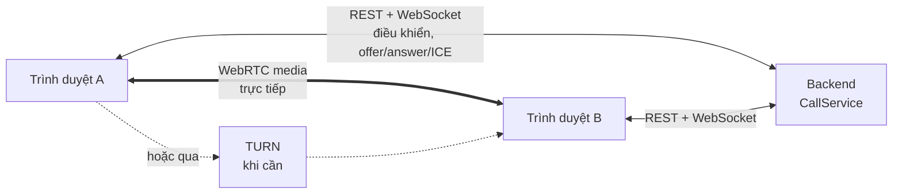
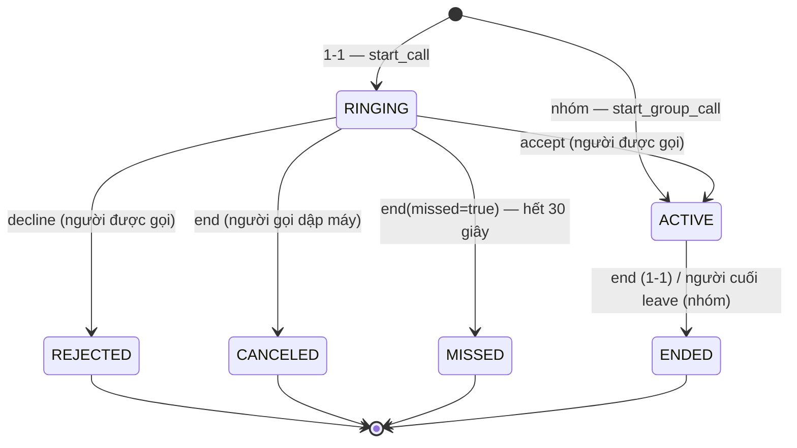
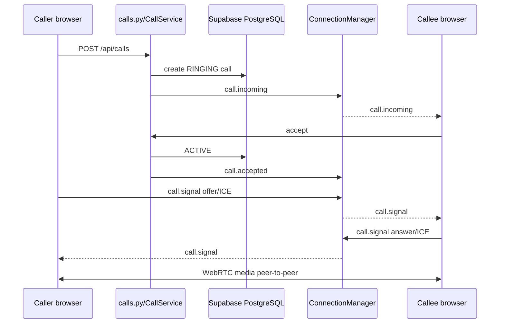

# 10. Tính năng gọi

## Ý tưởng chính: tách hai mặt phẳng

Một cuộc gọi có hai loại dữ liệu rất khác nhau, nên chúng đi hai đường khác nhau:

| Mặt phẳng | Gồm | Đi qua | Ai xử lý |
|---|---|---|---|
| **Điều khiển** (signaling) | Ai gọi ai, nhấc máy, dập máy, ai vào nhóm; offer/answer/ICE | REST + WebSocket qua backend | `CallService`, `Call` |
| **Media** | Âm thanh, hình ảnh | **Thẳng giữa hai trình duyệt** (hoặc qua TURN) | WebRTC của trình duyệt, `call.js` |

Backend **không bao giờ thấy** âm thanh hay hình ảnh. Kể cả khi đi qua TURN, TURN cũng chỉ
chuyển tiếp gói đã mã hóa (DTLS-SRTP), không giải mã được.



## Hai chế độ

| | 1-1 (`DIRECT`) | Nhóm (`GROUP`) |
|---|---|---|
| Bắt đầu | Bấm gọi trên một thành viên đang online | Bấm gọi nhóm ở đầu phòng |
| Đổ chuông | Có, 30 giây | Không — cuộc gọi mở ngay, ai muốn thì vào |
| Trạng thái ban đầu | `RINGING` | `ACTIVE` |
| Người tham gia | Đúng 2 | Tối đa **6** |
| Kết thúc khi | Một bên dập máy | Người **cuối cùng** rời đi |
| Điều kiện | Cả hai cùng phòng; không ai đang bận cuộc gọi khác | Là thành viên phòng; không đang bận cuộc gọi khác |

Cả hai đều có loại `AUDIO` (chỉ micro) hoặc `VIDEO`. Không mở được camera thì tự chuyển sang
chỉ micro.

**Mỗi người tối đa một cuộc gọi đang mở tại một thời điểm.** Gọi người đang bận trả `409`.

## Máy trạng thái

Toàn bộ luật chuyển trạng thái nằm trong thực thể `Call` (`domain/models/call.py`). Service
chỉ gọi phương thức; gọi sai thời điểm thì thực thể từ chối.



| Phương thức | Chỉ hợp lệ khi | Từ chối nếu |
|---|---|---|
| `accept(user)` | `RINGING` | Người gọi tự nhận; người lạ nhận |
| `decline(user)` | `RINGING` | Người gọi tự từ chối |
| `end(user, missed)` | Đang mở | Người không trong cuộc gọi |
| `join(user)` | Nhóm, `ACTIVE` | Đã đủ 6 người; không phải cuộc gọi nhóm |
| `leave(user)` | Đang trong cuộc gọi | — |

Mỗi người tham gia có trạng thái riêng (`CallParticipant`):

```
INVITED ──accept──► JOINED ──leave──► LEFT
   │                                    ▲
   └──decline──► DECLINED       join lại (nhóm)
```

Người từng rời cuộc gọi nhóm có thể vào lại; dòng `call_participants` cũ được dùng lại.

Mốc thời gian: `created_at` (bắt đầu), `answered_at` (nhấc máy — nhóm thì bằng lúc bắt đầu),
`ended_at`. Thời lượng = `ended_at − answered_at`.

## Luồng gọi 1-1



Group call dùng `POST /api/calls/group`, `call.room_started/updated/ended` và participant events. `GET /api/calls/config` cung cấp cấu hình để frontend khởi tạo peer connection. Route room active call giúp UI hiển thị call đang chạy.

Khi camera hoặc micro bị tắt, browser vẫn giữ media track nhưng frontend gửi trạng thái qua signaling để participant khác hiển thị avatar hoặc biểu tượng micro tắt. Query `?relay=1` chỉ có hiệu lực trong phiên trang hiện tại, không lưu vào `localStorage`; bỏ query để quay lại kết nối trực tiếp khi có thể.

## Traceability

`call.js` -> `api.js`/`ws.js` -> `routers/calls.py` và `routers/ws.py` -> `services/call_service.py` -> `repositories/call_repo.py` -> `CallModel`/`CallParticipantModel`.
