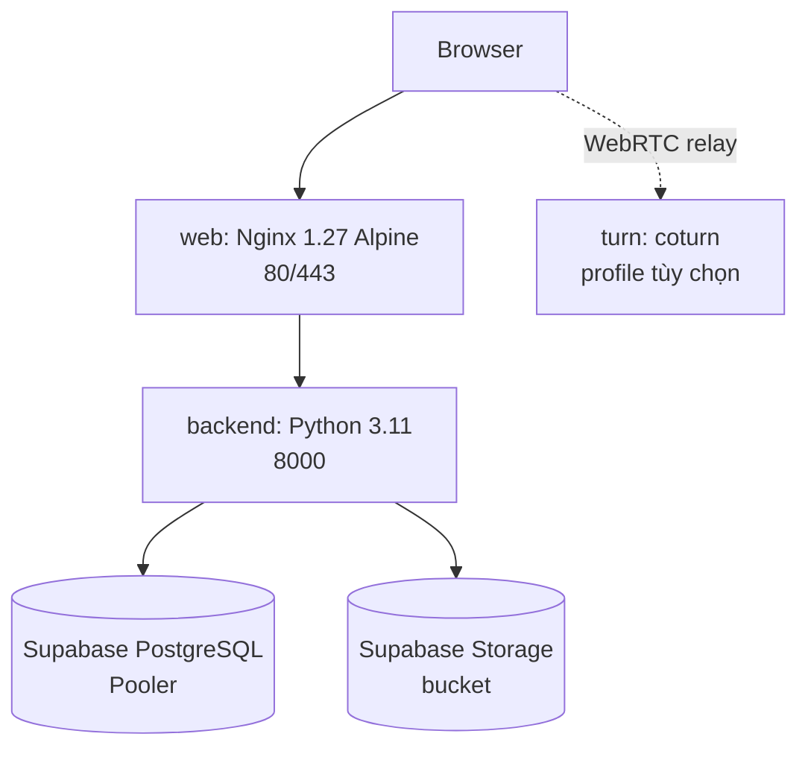

# 12. Triển khai

Hướng dẫn chạy từng bước cho người mới: [`RUN_GUIDE.md`](../RUN_GUIDE.md). Tài liệu này giải
thích **cấu trúc** triển khai và những điều cần biết khi vận hành.

## Sơ đồ container



| Service | Runtime/ports | Volume | Dependency |
| --- | --- | --- | --- |
| Supabase | PostgreSQL qua `DATABASE_URL` và Storage bucket | Managed bởi Supabase | cấu hình trong `.env` |
| `backend` | Python 3.11, host `${PORT:-8000}` -> 8000 | `./backend:/app` | không phụ thuộc service DB local |
| `web` | Nginx 1.27 Alpine, `${HTTP_PORT:-80}`, `${HTTPS_PORT:-443}` | frontend read-only, `certs:/etc/nginx/certs` | backend started |
| `turn` | `coturn/coturn:latest`, `network_mode: host`, profile `turn` | — | không chạy mặc định; bật bằng `docker compose --profile turn up -d` |

## Backend image

`backend/Dockerfile` cài requirements, tạo user `appuser`, đặt working directory và chạy Uvicorn. Runtime config đến từ `.env`/Compose; `DATABASE_URL` trỏ tới Supabase Pooler và các biến `SUPABASE_*` trỏ tới Storage bucket.

- Gốc `python:3.11-slim`.
- Cài `requirements.txt` trước khi chép mã nguồn, để sửa code không phải cài lại thư viện.
- Tạo sẵn `/app/uploads` thuộc `appuser` — nếu không, volume gắn vào sẽ thuộc root và tiến
  trình không ghi được tệp.
- **Chạy bằng `appuser`, không phải root.** Kẻ tấn công chiếm được tiến trình cũng chỉ có quyền
  của `appuser`.
- Lệnh chạy: `uvicorn app.main:app --host 0.0.0.0 --port 8000` — **một worker**.

## Truy cập từ bên ngoài

| Người dùng ở | Cách | Cần thêm |
|---|---|---|
| Cùng máy | `https://localhost` | — |
| Cùng Wi-Fi | `https://<IP LAN>` | IP nằm trong `CERT_IPS`; tường lửa cho cổng 443; mạng không bật cách ly thiết bị |
| Mạng khác | Cloudflare Tunnel: `cloudflared tunnel --url http://localhost:8080` | TURN để gọi được |

Mạng trường học, quán cà phê thường bật **cách ly thiết bị** (client isolation): các máy cùng
Wi-Fi không nhìn thấy nhau. Khi đó cách "cùng Wi-Fi" không dùng được, phải dùng tunnel.

Compose dùng `PORT`, `HTTPS_PORT`, `HTTP_PORT`, `CERT_IPS`, `TUNNEL_PORT` và `ICE_SERVERS`. Backend dùng `DATABASE_URL`, `SUPABASE_URL`, `SUPABASE_SERVICE_ROLE_KEY`, `SUPABASE_STORAGE_BUCKET`, `JWT_SECRET_KEY` và `ACCESS_TOKEN_EXPIRE_MINUTES`. Nếu bật profile `turn`, cần thêm `TURN_EXTERNAL_IP`, `TURN_USER`, `TURN_PASSWORD` và khai báo ICE server tương ứng.

Chi tiết: [15](15-third-party-services.md), [16](16-goi-xuyen-mang-lam-may-chu.md).

## Kiểm tra sức khỏe

```bash
docker compose ps                          # cả 3 phải "Up", db phải "healthy"
curl -k https://localhost/health           # {"status":"ok", ..., "online_users": N}
docker compose logs backend --tail 50      # tìm "Application startup complete"
```
