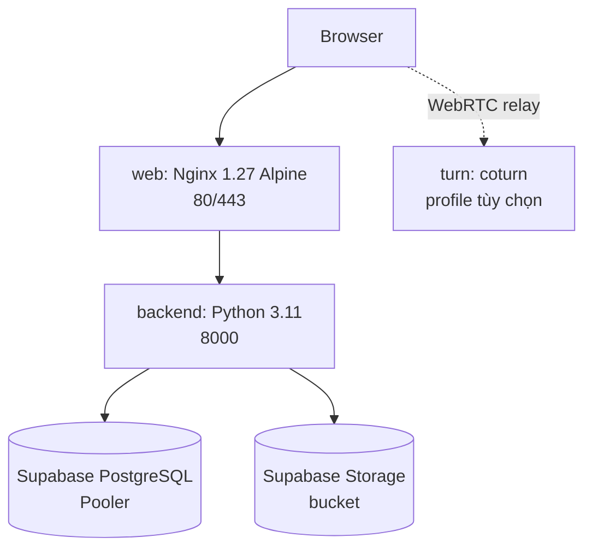

# 12. Deployment

## Compose topology

| Service | Runtime/ports | Volume | Dependency |
| --- | --- | --- | --- |
| Supabase | PostgreSQL qua `DATABASE_URL` và Storage bucket | Managed bởi Supabase | cấu hình trong `.env` |
| `backend` | Python 3.11, host `${PORT:-8000}` -> 8000 | `./backend:/app` | không phụ thuộc service DB local |
| `web` | Nginx 1.27 Alpine, `${HTTP_PORT:-80}`, `${HTTPS_PORT:-443}` | frontend read-only, `certs:/etc/nginx/certs` | backend started |
| `turn` | `coturn/coturn:latest`, `network_mode: host`, profile `turn` | — | không chạy mặc định; bật bằng `docker compose --profile turn up -d` |

## Backend image

`backend/Dockerfile` cài requirements, tạo user `appuser`, đặt working directory và chạy Uvicorn. Runtime config đến từ `.env`/Compose; `DATABASE_URL` trỏ tới Supabase Pooler và các biến `SUPABASE_*` trỏ tới Storage bucket.

## Nginx

`deploy/nginx/nginx.conf` phục vụ `/` từ `/usr/share/nginx/html`, redirect HTTP sang HTTPS, proxy `/api/`, `/docs`, `/redoc`, `/health` đến `backend:8000`, và proxy `/ws` với WebSocket upgrade. Upload limit là `30m`.

`10-gen-cert.sh` tạo self-signed certificate với SAN cho localhost, `127.0.0.1` và IP trong `CERT_IPS`. HTTPS cần cho quyền microphone/camera của browser. Thư mục root `nginx/` hiện không được Compose sử dụng; cấu hình active nằm ở `deploy/nginx/`.

## Environment và lưu ý

Compose dùng `PORT`, `HTTPS_PORT`, `HTTP_PORT`, `CERT_IPS`, `TUNNEL_PORT` và `ICE_SERVERS`. Backend dùng `DATABASE_URL`, `SUPABASE_URL`, `SUPABASE_SERVICE_ROLE_KEY`, `SUPABASE_STORAGE_BUCKET`, `JWT_SECRET_KEY` và `ACCESS_TOKEN_EXPIRE_MINUTES`. Nếu bật profile `turn`, cần thêm `TURN_EXTERNAL_IP`, `TURN_USER`, `TURN_PASSWORD` và khai báo ICE server tương ứng.

`turn` dùng host networking và dải relay UDP `50000-50010`, cổng lắng nghe `3478`; `TURN_EXTERNAL_IP` phải là IP LAN thật, không dùng `127.0.0.1`. Khi gọi qua Internet, có thể dùng TURN bên ngoài và Cloudflare Tunnel theo [15 - Dịch vụ bên thứ ba](15-third-party-services.md).
