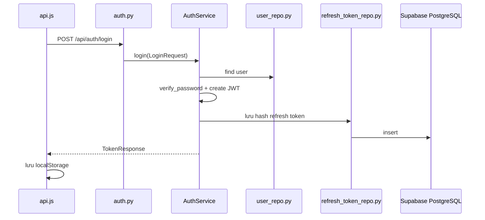
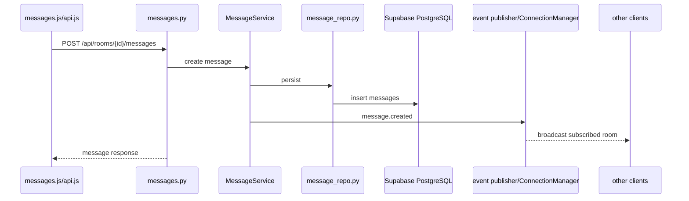

# 14. Luồng hoạt động

Mỗi luồng được vẽ **qua đủ các tầng**, với tên file và hàm thật, để có thể mở code ra đọc theo.
Cách các tầng nối với nhau về nguyên tắc: [02](02-architecture.md).

Ký hiệu tầng trong sơ đồ:

| Tiền tố | Tầng | Thư mục |
|---|---|---|
| **FE** | Frontend | `frontend/js/` |
| **API** | Giao tiếp | `backend/app/api/` |
| **SVC** | Ứng dụng | `backend/app/services/` |
| **DOM** | Nghiệp vụ lõi | `backend/app/domain/models/` |
| **REPO / INFRA** | Hạ tầng | `backend/app/repositories/`, `backend/app/infra/` |

---

## 1. Đăng nhập

Người gửi nhận tin của chính mình **hai lần**: một lần trong phản hồi `201`, một lần qua
`message.created`. Frontend bỏ bản trùng theo `id`.

`publish_to_room` được gọi từ code đồng bộ trong threadpool; `ConnectionManager` dùng
`run_coroutine_threadsafe` đẩy việc gửi sang event loop chính.

---

## 3. Tìm và tham gia phòng công khai

Thứ tự hai lệnh cuối quan trọng: phát `member_left` **trước** rồi mới thu hồi, nên người bị xóa
còn kịp biết để đóng phòng. Hai coroutine vào event loop theo thứ tự xếp hàng.

Quyền kiểm tra ở hai nơi khác nhau: "có quyền quản lý thành viên không" và "ai cao hơn ai" là
câu hỏi gửi cho **thực thể** `RoomMember`; còn "người bị xóa không được vào lại" là việc của
**service**, vì nó cần ghi vào một bảng khác.

---

## 5. Lời mời

`messages.js/profile.js/rooms.js -> multipart API -> router -> service -> SupabaseFileStorage.save() -> Supabase Storage bucket + metadata/attachment repository hoặc avatar field -> response`. Attachment download đi qua `GET /api/attachments/{attachment_id}` và kiểm tra quyền room.

Toàn bộ luật "được vào không" nằm trong `Call.join()` — service chỉ nạp, gọi, lưu, phát. Âm
thanh và hình ảnh không bao giờ đi qua backend.

---

## Tóm tắt: mỗi tầng làm gì trong mọi luồng

| Use case | Entry points | Core implementation |
| --- | --- | --- |
| Login/refresh | `frontend/js/api.js`, `auth.py` | `auth_service.py`, `jwt.py`, `password.py`, token repositories |
| Room/member | `frontend/js/rooms.js` | `rooms.py`, `room_service.py`, `room_repo.py` |
| Message | `frontend/js/messages.js` | `messages.py`, `message_service.py`, `message_repo.py` |
| Realtime | `frontend/js/ws.js` | `ws.py`, `connection_manager.py`, event publisher |
| Profile | `frontend/js/profile.js` | `users.py`, `user_service.py`, `user_repo.py` |
| Call | `frontend/js/call.js` | `calls.py`, `call_service.py`, `call_repo.py` |
| Files | `frontend/js/api.js` and feature modules | `file_storage.py`, `supabase_storage.py`, attachment/avatar routes |
