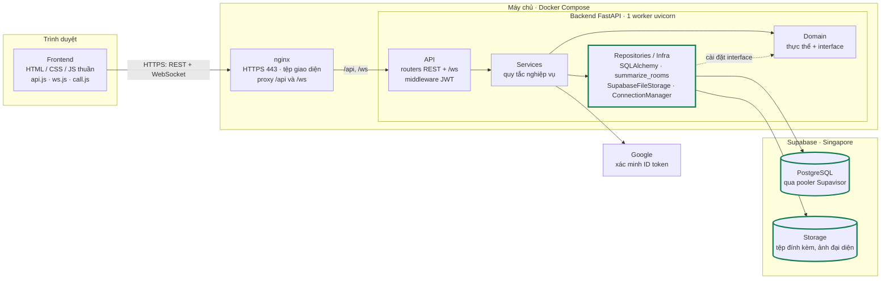
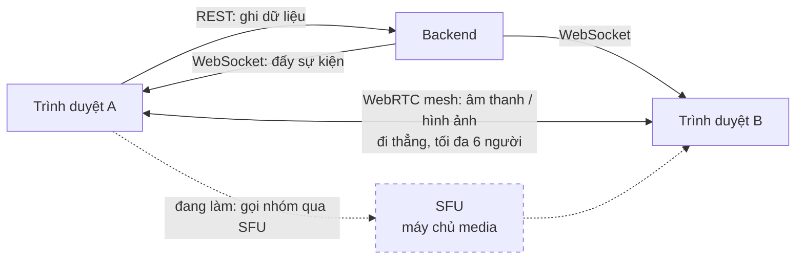
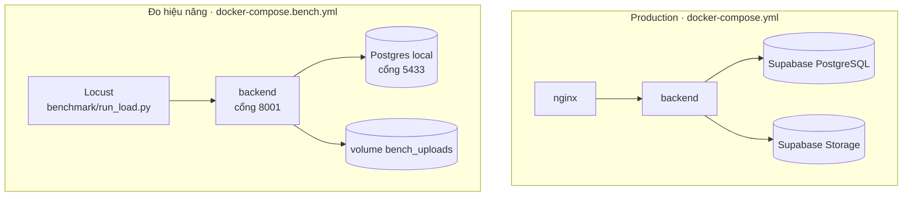

# 17. Kiến trúc hiện tại (pha 2)

Kiến trúc tại thời điểm 10/11/2026, sau các cải tiến pha 2 đã vào code. Kiến trúc pha 1 xem
tag `phase1-baseline` (commit `aec3478`), tài liệu `docs/01` ở tag đó và slide
`Team-Chat-Baseline-demo.pptx`.

Hệ thống vẫn là **monolith phân tầng**: một tiến trình FastAPI chứa toàn bộ nghiệp vụ, chia
4 tầng giao tiếp qua interface. Thay đổi lớn nhất so với pha 1 là **dữ liệu và tệp ra khỏi
máy chủ**, chuyển lên Supabase.

## Sơ đồ thành phần

Khối viền xanh là chỗ đã đổi so với pha 1, khối nét đứt là phần đang làm.

## Ba kênh giao tiếp

Quy ước giữ nguyên từ pha 1: **ghi qua REST, nhận thay đổi qua WebSocket**. Tín hiệu bắt tay
cuộc gọi (offer / answer / ICE) đi qua WebSocket. STUN dùng máy chủ công khai; TURN khai
qua biến `ICE_SERVERS`.

## Bốn tầng backend

| Tầng | Thư mục | Vai trò | Đổi ở pha 2 |
|---|---|---|---|
| API | `app/api/` | Router REST và `/ws`, middleware xác thực JWT, đổi ngoại lệ thành mã HTTP | — |
| Services | `app/services/` | Quy tắc nghiệp vụ: phòng, tin nhắn, quyền, cuộc gọi | — |
| Domain | `app/domain/` | Thực thể và interface (`I*Repository`, `IFileStorage`, `IEventPublisher`) | — |
| Repositories / Infra | `app/repositories/`, `app/infra/` | Cài đặt interface: SQLAlchemy, lưu tệp, WebSocket | `summarize_rooms`, `SupabaseFileStorage`, chọn bộ lưu tệp bằng `STORAGE_BACKEND` |

Cả hai cải tiến dữ liệu đều chỉ chạm tầng dưới cùng. Tầng Services và Domain không đổi, đúng
như mục đích của việc tách interface: đổi nơi lưu tệp chỉ thay lớp cài đặt `IFileStorage`,
bỏ N+1 chỉ thay cách repository truy vấn.

## Thay đổi so với pha 1

| Thành phần | Pha 1 | Hiện tại | Trạng thái | Phụ trách |
|---|---|---|---|---|
| Cơ sở dữ liệu | Container Postgres chung máy với backend | Supabase Managed PostgreSQL qua pooler | Xong | Dũng |
| Lưu tệp | Volume `uploads` trên máy chủ | Supabase Storage qua `IFileStorage` | Xong | Dũng |
| Danh sách phòng | 1 + 4N truy vấn (vòng lặp từng phòng) | Luôn 4 truy vấn (`summarize_rooms`) | Xong | Đạt |
| Môi trường đo | Không có | `docker-compose.bench.yml` + Locust | Xong | Đạt |
| Gọi nhóm | WebRTC mesh, tối đa 6 người | Chuyển sang SFU | Đang làm | Nhân |
| Realtime nhiều worker | WebSocket trong bộ nhớ, 1 worker | Chưa đổi; dự kiến Redis Pub/Sub | Đang làm | — |
| Máy chủ TURN | Container coturn (profile tùy chọn) | Không còn trong compose; dùng TURN ngoài qua `ICE_SERVERS` | Đã đổi | — |

## Hai môi trường chạy

| | Production | Đo hiệu năng |
|---|---|---|
| Database | Supabase | Postgres local, 2000 user ảo, 400 phòng |
| Lưu tệp | Supabase Storage | Volume local (`STORAGE_BACKEND=local`) |
| Cấu hình | `.env` | Ghi trong file compose, không đọc `.env` |
| Vào bằng | nginx, HTTPS 443 | Thẳng backend, cổng 8001 |

Hai môi trường chạy song song được, không dùng chung dữ liệu. Cách chạy:
[`benchmark/README.md`](../benchmark/README.md).

## Giới hạn hiện tại (đo được)

| Đo | Kết quả với 1 worker |
|---|---|
| Gửi tin | Chịu được khoảng 100–120 người dùng đồng thời; kẹt hẳn từ 150 |
| Danh sách phòng | p95 1983 → 202 ms ở 50 người sau khi bỏ N+1 |
| Nguyên nhân kẹt | Bể kết nối DB (5 + 10) cạn khi 40 luồng của FastAPI cùng chờ; CPU còn dư |

Chi tiết: `benchmark/experiments/*/results/report_summary.md`.

Các giới hạn kiến trúc còn lại:

- **Một worker.** `ConnectionManager` giữ danh sách kết nối WebSocket trong bộ nhớ của tiến
  trình, nên chạy nhiều worker thì người ở worker này không nhận được sự kiện từ worker kia.
  Cần kênh dùng chung như Redis Pub/Sub.
- **Bể kết nối DB** nhỏ hơn số luồng xử lý request: nút thắt đầu tiên khi tải tăng.
- **Gọi nhóm dạng mesh** tối đa 6 người; mỗi người gửi một luồng tới từng người khác.
